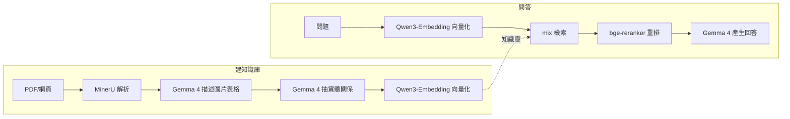

# rag-anything-lab

用 [RAG-Anything](https://github.com/HKUDS/RAG-Anything) 1.4.3（底層 LightRAG 1.4.16）建立的本地 RAG 實驗環境，PoC 的目標是測試「本機模型＋這套方法」能不能回答台新銀行信用卡與金融卡的問題，作為之後智能客服問答的基礎。

- 四個指令：`ingest` 匯入文件、`query` 提問、`eval` 用題目檔批次評估、`graph` 抽樣檢視知識圖譜。
- 目前的知識庫：台新銀行信用卡與金融卡的官網內容，325 份文件。
- 目前進行中的規格：`.scratch/rag-optimization/`（回答品質優化）。過去各階段的規格與 ticket 在 `.scratch/` 其他資料夾。
- 每個目錄與程式的用途見 [`docs/architecture.md`](docs/architecture.md)。
- 管線裡每一步都用本機模型。Claude 只負責設計、寫程式與判讀 eval 結果，不改寫問題、不抽關鍵字、不產生答案。

## 1. 使用的模型

所有模型都在本機執行，由同一個 MLX server（port 8081）提供，端點與模型名稱寫在 `.env`。

| 模型 | 建知識庫 | 問答 | 用途 |
|---|---|---|---|
| MinerU（`pipeline` 後端） | ✓ | — | 把 PDF 拆成文字、表格、圖片；內建版面分析與 OCR 模型 |
| `mlx-community/gemma-4-26b-a4b-it-4bit` | ✓ | ✓ | 同一個模型做三件事：描述圖片與表格、抽取實體與關係、產生回答 |
| `mlx-community/Qwen3-Embedding-4B-4bit-DWQ`（2560 維） | ✓ | ✓ | 把文件 chunk 與問題轉成向量；兩邊必須用同一個模型 |
| `BAAI/bge-reranker-v2-m3` | — | ✓ | 把候選 chunk 依和問題的相關程度重新排序 |



- Gemma 4 26B A4B 是 MoE 模型，每個 token 用到約 4B 參數；權重 15.3 GB。
- embedding 模型決定了知識庫的向量維度，換 embedding 就要重建知識庫（第 7 節）。
- 這是 PoC 的設定：一台 32 GB Mac 一次只處理一個請求。正式的智能客服如果要多人同時使用，部署方式與模型大小要另外規劃。

## 2. 檢索、重排與回答的條數

只用 `mix` 模式（LightRAG 的圖譜檢索加向量檢索）。下表的設定值來自 `.env` 與 `rag_lab/pipeline.py`；實際條數是 2026-11-12 的 28 題 eval（`output/answer_prompt_01/eval.log`，舊知識庫）的平均。新知識庫的 chunk 大小不同，實際條數要在 rag-optimization ticket 07 重新量。

| 階段 | 設定 | 實際條數 |
|---|---|---|
| 圖譜檢索：實體 | `top_k=40`（LightRAG 預設） | local 40 個＋global 約 60 個 |
| 圖譜檢索：關係 | `top_k=40` | 加上實體連到的關係，600–1,000 條 |
| 向量檢索 chunk | `chunk_top_k=20`、相似度門檻 0.2 | 20 條 |
| 圖譜連到的 chunk | 每個實體或關係最多 5 條 | 和向量 chunk 合併、去重 |
| 重排前的候選 | | 20–27 條 chunk |
| bge-reranker 重排 | 保留前 20 條，分數門檻 0 | 20 條 |
| 送進 Gemma 的 context | 總上限 12,000 token；實體、關係各 500 token | 實體約 2 個、關係約 2 條、chunk 7–10 條（平均 8 條） |

- 重排後依序放進 context，放到 12,000 token 為止，所以 20 條裡通常只有前 8 條左右送進 Gemma。
- 12,000 是 2026-10-26 為了避免查詢時 GPU 記憶體不足而設的（當時 LightRAG 預設 30,000，prompt 有 29.7k token）。那時的 LLM 是 Qwen3-4B，跑在另一個 server。2026-11-23 用 Gemma 4 重新量測：16,000、20,000 的 wired 記憶體最高都是 24 GB，但答對題數沒有變多（內容 ✓ 12k／16k／20k＝18／15／17），28 題 eval 從 21 分鐘變成 24.7、25.8 分鐘，所以維持 12,000。
- 實體與關係的上限 500／500 是為 mix 調的（ticket 13，2026-11-01）：mix 答對題數 4 → 7。
- 所有查詢都先重排（沒有開關）；重排失敗時該次查詢直接失敗，不會改用沒重排的順序。
- 回答提示詞的第 6 點放 `rag_lab/pipeline.py` 的 `ANSWER_INSTRUCTIONS`：先分清楚問題講的是信用卡還是金融卡，兩種卡的資料分開寫；每段開頭標「【卡別｜卡名】」；子問題逐一回答；金額、日期照原文寫。段首標記讓卡別清楚，但答案會比較重複。

## 3. 建立環境

需求：Apple Silicon Mac（本文件的數據都在 M2 Pro、32 GB 上量測）、[pyenv](https://github.com/pyenv/pyenv)、[pipx](https://pipx.pypa.io/)。

```sh
pyenv install --skip-existing 3.12.12
"$(pyenv root)/versions/3.12.12/bin/python" -m venv .venv
.venv/bin/pip install -r requirements.txt
pipx install mlx-vlm==0.7.10
brew install --cask libreoffice   # 只有匯入 Word、PPT、Excel 時需要
cp .env.example .env
```

- MLX server 用 pipx 另外安裝，不放進專案 venv，避免和 MinerU、torch 的相依衝突。
- `.env.example` 的每個欄位都有註解；`.env` 不進版本控管。
- **中文 Office 文件**：headless 的 LibreOffice 預設找不到 macOS 的系統字型，轉出的 PDF 中文是 0 字。在 `.env` 設 `FONTCONFIG_FILE=/絕對路徑/llm-lab/scripts/libreoffice-fonts-macos.conf`（2026-10-30 實測：0 字 → 7,265 字）。
- **會被拒絕的環境變數**：LightRAG、RAG-Anything、MinerU 會從環境變數讀 39 個設定（`TOP_K`、`CHUNK_SIZE`、`WORKSPACE` 等），設了會改變結果而且不報錯。rag_lab 發現它們出現在環境變數或 `.env` 時，在啟動時以設定錯誤中止。名單、收錄標準與升級套件時的更新步驟寫在 `rag_lab/config.py` 的模組說明。

## 4. 下載資料

```sh
.venv/bin/python scripts/fetch_taishin.py            # 下載，並依卡片標籤改檔名
.venv/bin/python scripts/fetch_taishin.py --update   # 更新模式：比對內容，變了才換，下架的搬走
```

從台新官網與 richart.tw 下載到 `data/taishin_credit_card/`，請求之間至少間隔 2 秒。需要 Google Chrome 與 LibreOffice。

| 資料夾 | 內容 | 格式 | 份數 |
|---|---|---|---|
| `cards/` | 信用卡卡片頁 | PDF（Chrome 列印） | 16 |
| `debit_cards/` | 金融卡卡片頁 | PDF（Chrome 列印） | 5 |
| `richart/` | richart.tw 的信用卡頁與簽帳金融卡頁 | PDF（Chrome 列印） | 2 |
| `rights/` | 信用卡權益說明子頁 | `.docx` | 43 |
| `downloads/` | 信用卡文件下載區 | PDF | 19 |
| `debit_info/` | 金融卡說明頁（費用、常見問題等） | PDF（Chrome 列印） | 6 |
| `debit_terms/` | 金融卡約定條款 | PDF | 4 |
| `richart_discounts/` | Richart 優惠細則 | PDF（Chrome 列印） | 13 |
| `offers/` | 刷卡優惠活動頁 | PDF（Chrome 列印） | 191 |
| `offer_images/` | 活動主視覺 | JPG、PNG | 9 |
| `rights_attachments/` | 權益子頁連到的 PDF（聯名卡條款等） | PDF | 17 |

- 份數是 2026-11-20 重匯時的數量，合計 325 份。
- **檔名格式**：`<卡別>_<卡名｜多卡｜全部>_<原檔名>`，例如 `信用卡_台新Richart卡_card_cg047_card001.pdf`。卡片標籤由 `scripts/label_cards.py` 依規則產生，`scripts/label_cards_manual.json` 的人工標籤優先。下載完成後 `fetch_taishin.py` 自動改名；`--keep-names` 只下載不改名。
- **標頭檔**：`data/taishin_credit_card/_meta/document_headers.json` 記每份文件的標頭（`卡別：…｜適用卡片：…`），匯入時放在每個 chunk 開頭。舊檔名一次遷移用 `scripts/rename_documents.py`（`--dry-run` 先看清單）。
- **網頁轉檔**：卡片頁、權益頁、活動頁先取出主內容區、拿掉官網的 CSS 再轉檔，否則預設收合的區塊會印不出來（Richart 卡片頁 1,074 字 → 34,576 字）。
- **更新模式**的規則（內容比對、下架判斷、活動過期、圖片名額）寫在 `scripts/fetch_taishin.py` 的模組說明。官網列表沒有成功取得時，那個類別這次不判斷下架。
- `_meta/` 存原始 HTML、轉檔用 HTML 與下載清單 `manifest.jsonl`，不會被匯入。
- 台新官網禁止未經授權的重製。`data/`、`rag_storage/`、`output/` 都不進版本控管。這個 repo 是公開的，題目檔的參考答案、`.scratch/` 的規格、`docs/*.html` 與 `eval_results/` 引用了部分官網原文，由 repo 擁有者決定公開。
- 前一版知識庫（RAG 論文與文件，2026-10-30 刪除）的下載腳本 `scripts/fetch_papers.py`、`scripts/fetch_documents.py` 仍保留，用法見各自的 `--help`。

## 5. 啟動本地模型 server

每次開機後先關掉其他軟體，把 GPU 記憶體上限設為 26000 MB（要 sudo，重開機會恢復預設）：

```sh
sudo sysctl iogpu.wired_limit_mb=26000; sysctl iogpu.wired_limit_mb
```

在 repo 根目錄啟動 server：

```sh
~/.local/share/pipx/venvs/mlx-vlm/bin/python scripts/vlm_server.py --mlx-cache-limit-gb 1 \
  --host 127.0.0.1 --port 8081 \
  --model mlx-community/gemma-4-26b-a4b-it-4bit \
  --embedding-model mlx-community/Qwen3-Embedding-4B-4bit-DWQ \
  --reranker-model BAAI/bge-reranker-v2-m3 \
  --max-tokens 4096
```

確認端點可用（chat、圖片、embedding 維度）：

```sh
.venv/bin/python scripts/smoke_test.py
```

- `scripts/vlm_server.py` 把 MLX 的 GPU buffer cache 上限設為 1 GB 再啟動 `mlx_vlm.server`：mlx-vlm 0.7.10 的 embedding 路徑不清 cache，不設的話匯入期間 server 會從 5 GB 增加到 13 GB。
- `.env` 的 `LLM_MAX_ASYNC` 要設 1：設 2 時兩個長請求同時產生，GPU 記憶體不足。
- thinking 不開（Gemma 4 的 chat template 預設 `enable_thinking=false`）。
- 長時間匯入或 eval 時，另外開記憶體監控 `output/crash_repro/tools/watchdog.sh`（要用 `zsh` 執行，wired 記憶體超過門檻就停掉 server）。它在 `output/`，不在版本控管裡。
- 已知限制：`query --vlm-enhanced`（約 11k token 的 prompt 加 1 張圖片）在 prefill 時 wired 到 27 GB，沒有完成。

## 6. 使用

不需要先 activate venv。

```sh
# 匯入單一檔案或整個資料夾（資料夾不遞迴，已完整匯入的文件會略過）
.venv/bin/python -m rag_lab ingest data/taishin_credit_card/cards

# 提問，預設 mix
.venv/bin/python -m rag_lab query "台新Richart卡國內一般消費回饋是多少？"

# 抽樣檢視知識圖譜（不需要 server）
.venv/bin/python -m rag_lab graph

# 批次評估，只跑 mix；結果寫到 eval_results/eval_<時間>.md
.venv/bin/python -m rag_lab eval eval/questions.taishin.jsonl --modes mix
```

從頭重建台新知識庫（接上電源、不要合上蓋子：`caffeinate` 擋不住合蓋睡眠）：

```sh
caffeinate -i -s zsh -c 'for d in cards debit_cards richart rights downloads debit_info debit_terms richart_discounts offers offer_images rights_attachments; do
  .venv/bin/python -m rag_lab ingest data/taishin_credit_card/$d
done'
```

- **防止睡眠要包住整個迴圈**：這台 Mac 的系統設定是閒置 1 分鐘就睡眠。`caffeinate` 只在它包住的程式執行期間擋睡眠；如果每個資料夾各包一次，兩個資料夾之間的空檔就會睡著，之後只靠系統短暫的背景喚醒斷斷續續地跑，還常因為溫度過高被強制睡回去（2026-11-22 重匯時發生過）。`-s` 讓接著電源時也不進系統睡眠。跑 eval 等長時間工作也一樣。

- **支援格式**：PDF、PPT、Word、Excel（含舊格式 `.ppt` `.doc` `.xls`）、常見圖片格式。Office 文件先用 LibreOffice 轉成 PDF。以 `.` 或 `~$` 開頭的檔案不匯入。
- **依標題切塊**（設了 `DOCUMENT_HEADERS_FILE` 時）：在 MinerU 標出的標題處切開，少於 100 token 的節併進下一節，chunk 上限 1,200 token；每個 chunk 開頭是標頭加章節名稱。規則與已知極限寫在 `rag_lab/chunking.py` 的模組說明。
- **大表格**：超過 800 token 的表格先拿掉多餘的合併屬性，仍超過就依列切成小表、每張重複表頭列（`rag_lab/tables.py`）。
- **知識庫的語言與實體類型**：`KB_LANGUAGE`、`KB_ENTITY_TYPES` 必填，改了要重匯才會反映。
- **增量更新**：`ingest` 在 `rag_storage/rag_lab_documents.json` 記每個路徑對應的文件 ID。同一個路徑內容變了，再 `ingest` 會先匯入新版本、成功後才刪舊版本；來源已不在的文件先列出，確認後加 `--prune` 才刪。報告把每份文件分成新增、替換、沒變、失敗。細節見 `docs/architecture.md`。
- **答案快取**：`ingest` 改動知識庫時會自動清掉查詢答案的快取。換了 `LLM_MODEL` 或 `RERANK_MODEL` 時不會自動清，要先從 `rag_storage/kv_store_llm_response_cache.json` 刪掉 key 含 `:query:` 的項目再跑 `eval`，否則會拿到舊模型的答案。
- **失敗處理**：圖、表描述或寫入知識庫失敗時，那份文件記成失敗（結束碼 1），同一批其他文件照常匯入；修好後重跑同一個 `ingest` 會重試。
- **Python API**：

  ```python
  from rag_lab.pipeline import Session

  with Session() as session:
      answer = session.query("台新Richart卡國內一般消費回饋是多少？", mode="mix")
  ```

  完整範例在 `examples/query_from_python.py`，`Session`、`ingest`、`evaluate` 的規則見 `docs/architecture.md` 第 4 節。

## 7. 實測數據

### 這次重匯的耗時（2026-11-20 起，rag-optimization ticket 06）

設定：第 1 節的模型、依標題切塊、繁體中文抽取、10 種實體類型。檔名全部改過，MinerU 的解析快取失效，每份都重新解析。log 在 `output/rag_opt/reingest/`。

| 資料夾 | 份數 | 這次耗時 | 前一次耗時（Qwen3-4B，2026-10-30～11-04） |
|---|---|---|---|
| `cards` | 16 | 16:18:20 | 9:42:41 |
| `debit_cards` | 5 | 1:17:09 | 5 個金融卡資料夾合計 2:20（2026-11-04） |
| `richart` | 2 | 0:38:42 | 同上 |
| `rights` | 43 | 6:16:21 | 2:58:14 |
| `downloads` | 19 | 6:35:29 | 3:26:01 |
| `debit_info` | 6 | 0:52:00 | 同上 |
| `debit_terms` | 4 | 2:28:14 | 同上 |
| `richart_discounts` | 13 | 1:32:07 | 同上 |
| `offers` | 191 | 17:42:06 | 12:34:44（200 份） |
| `offer_images` | 9 | 0:18:14 | 0:05:15（8 份） |
| `rights_attachments` | 17 | 5:50:30 | 0:48:59 |
| **合計** | 325 | **59:49:12**（11-20 17:58 → 11-23 05:47） | 約 30 小時 |

- 325 份全部成功（11 個資料夾 rc=0、doc status 全是 processed）；wired 記憶體最高 25 GB（門檻 27 GB），watchdog 沒觸發。
- 結果：chunk 3,325、實體 11,552、關係 30,463；舊知識庫是 2,341／18,297／37,027。chunk 多是因為依標題切塊、多了 31 份；實體少 37% 的原因還沒查證（可能是中英名稱不再重複，也可能是格式錯誤丟棄變多）。
- `offers` 後段（`信用卡_多卡`）每份比較慢：條款長、每個 chunk 抽出的東西多，不是機器變慢（server 解碼一直約 47 tok/s）。
- 上表的耗時包含 Mac 睡著的時間：重匯期間資料夾之間的空檔沒有擋睡眠（當時的指令是每個資料夾各包一次 `caffeinate`），`debit_info`、`debit_terms`、`richart_discounts`、`offers` 前段與 `rights_attachments` 有幾段時間大部分在睡，實際執行時間比表上短。
- 比前一次慢的原因：前一次抽取用 Qwen3-4B（另一個 server），這次用 Gemma 4 26B A4B；embedding 從 0.6B 換成 4B；所有文件重新解析。
- 抽取格式錯誤：Gemma 的抽取輸出有一部分格式錯誤（分隔符號寫壞、關係少了 keywords 欄位），LightRAG 會整筆丟棄（`cards` 丟了實體 2.1%、關係 5.6%，前一次是 1.0%、0.3%）。已加上修補（`rag_lab/extraction_repair.py`），並用快取裡的抽取輸出增量合併進知識庫：救回實體 342 筆、關係 1,085 筆。同 20 個 chunk 的小實驗：Qwen3-4B 抽取 0% 丟棄，Gemma 用英文 prompt 反而更差（關係丟 15.9%），所以先維持 Gemma＋修補。
- 44 次抽取輸出寫到 4096 token 上限，內容是重複迴圈或思考文字外漏。LightRAG 仍會解析迴圈前的正常紀錄，損失小，決定不處理；上限也不能降（正常輸出有 69 次超過 2,048）。

### 過去的里程碑

| 日期 | 事件 | 結果 | 紀錄 |
|---|---|---|---|
| 2026-10-30～31 | 全量匯入 286 份、追加到 311 份 | 約 30 小時，全部成功 | `.scratch/taishin-credit-card-kb/` |
| 2026-11-01 | 3 次 eval，加 reranker | mix ✓ 4 → 7 → 9（20 題） | `docs/taishin-eval-final.html` |
| 2026-11-03 | 重匯大表格的 22 份 | 超過 2,000 token 的 chunk 32 → 2 | `.scratch/chunk-truncation/` |
| 2026-11-03～04 | 同步官網、`--prune` | 新增 6、替換 33、刪除 23 | `.scratch/incremental-update/` |
| 2026-11-04 | 加入金融卡 30 份 | 金融卡 8 題 ✓ 0 → 2 | `docs/debit-card-eval.html` |
| 2026-11-11 | LLM 從 Qwen3-4B 換成 Gemma 4 | 內容 ✓ 8 → 14（28 題） | `docs/gemma4-vs-qwen-eval.html` |
| 2026-11-12 | 加回答附加指示（分清卡別） | 內容 ✓ 14 → 16 | `docs/answer-prompt-eval.html` |
| 2026-11-20～23 | 依標題切塊、卡片標籤、中文抽取、4B embedding，全量重匯；修補抽取格式錯誤 | 內容 ✓ 16 → 18、最終 ✓ 8 → 12 | `docs/rag-optimization-eval.html` |
| 2026-11-23 | 試查詢上限 16k、20k | 沒變好、變慢，維持 12k | 同上 |
| 2026-11-23 | 回答附加指示加段首卡別標記等 3 點 | 最終 ✓ 12 → 16（內容 ✓ 持平 18） | 同上 |

eval 由兩個沒參與撰寫的 agent 各自判讀（✓、△、✗），分歧由主對話裁決。不同時期的判讀規則不同（2026-11-04 起加了卡別規則），跨期的分數不能直接比較。

### 未來優化方向：為什麼還到不了 95%（2026-11-23 評估）

目前 28 題內容 ✓ 18（64%）、最終 ✓ 16（57%）。95% 等於最多錯 1 題。主因不只是模型，差距卡在三個地方：

| 卡在哪裡 | 題數 | 題目 | 原因 |
|---|---|---|---|
| 找不到資料 | 4 | rule-01、rule-02、terms-02、cross-02 | 該用的段落沒進 context（probe 分類 a），換多強的模型也答不出來 |
| 找到但答錯 | 6 | switch-01、switch-04、benefit-01、offer-03、cross-01、rule-03 | 漏列項目、推論錯（「部分適用」答成「全部適用」）、日期推算錯 |
| 題目與評估本身 | — | — | 題目平均 2 個以上子問題、12 題跨文件，漏一項就是 △；28 題同一設定重跑會差 1～2 題 |

- **找不到資料的 4 題，換模型沒有用**：就算回答完美，上限也只有 24/28（86%）。這幾題都要跨文件，或要指到特定條文（例如 rule-01 要同時用到「不回饋清單」和卡片頁，terms-02 要找到「第二十二條」）。mix 檢索主要靠語意相似度，條號、店名這種要字面對上的查詢是它的弱項，而且一次只放得下約 8 個 chunk。
- **找到但答錯的 6 題，有模型的因素**：Gemma 4 26B A4B 是 MoE，每次實際只用約 4B 參數，又是 4-bit 量化。更大的模型通常比較少犯這類錯，但這台 Mac 只有 32 GB，GPU 記憶體上限 26 GB，目前已用到 24 GB，換大模型的空間很有限。
- **題目與評估**：只有 28 題，雜訊本來就有 1～2 題，「穩定 95%」本身很難量出來。

**建議先做兩個診斷實驗，確認瓶頸在哪一段**（都不用重匯，各約 30～60 分鐘；回答一律由本機模型產生，Claude 只判讀）：

| 實驗 | 做法 | 回答什麼問題 |
|---|---|---|
| A. 給它正確資料 | 把每題標準來源的段落直接給 Gemma 回答，不經過檢索 | 資料完美時 Gemma 能答對幾題，也就是模型的上限 |
| B. 換回答模型 | 用同一份 context（probe 已存在 `output/rag_opt/probe07/contexts/`），換一個放得進記憶體的較大本機模型回答 | 答錯的 6 題裡有幾題是模型能力造成的 |

**依結果往下做：**

- **A 很高（例如 25 題以上）→ 瓶頸在檢索**：
  - 加關鍵字檢索（BM25），和語意檢索並用，處理條號、店名。
  - 讓本機模型先把多子問題拆開，分別檢索。
  - 依卡名先篩文件。
- **A 也不高 → 瓶頸在模型或題目**：換回答模型，或檢討題目與判準是不是太嚴。
- **另外記著、還沒做**：
  - 抽取改用 Qwen3-4B：小實驗格式錯誤 0%，要等 eval 看出是抽取不足造成答錯才考慮，需要重匯。
  - 下次全量重匯時，在匯入階段排除圖示圖。

## 8. 搬到別台機器

只改 `.env`，程式碼不動。

| 欄位 | 搬機器時 |
|---|---|
| `*_BASE_URL` | 改成新機器上的 OpenAI 相容端點（結尾含 `/v1`；rerank 端點要提供 `POST {RERANK_BASE_URL}/rerank`，Jina／Cohere 格式） |
| `LLM_MODEL`、`VLM_MODEL`、`RERANK_MODEL` | 改成新端點上的模型名稱 |
| `*_API_KEY` | 雲端 API 填真的金鑰；本機 MLX server 填任意非空字串 |
| `LLM_MAX_ASYNC`、`EMBED_MAX_ASYNC` | 記憶體較大的機器或雲端 API 可以調高 |
| `QUERY_MAX_*_TOKENS` | 依新 LLM 的 context 長度與記憶體調整 |
| `EMBED_MODEL`、`EMBED_DIM` | **不能改**，除非重建知識庫 |

- 換 embedding 要把 `WORKING_DIR` 改到新的資料夾再重新匯入：LightRAG 的向量檔名不含模型名稱，沿用舊資料夾會讓新舊向量混在一起。
- 換 LLM 只影響之後的抽取與回答；已建好的圖譜是舊 LLM 抽的，要重建才會改變。LightRAG 文件建議 LLM 至少 32B 參數、context 至少 32K token，目前的設定低於這個建議。
- 文件 ID 含圖片的絕對路徑：專案資料夾搬到別的路徑，或改了 `PARSER_OUTPUT_DIR`，同一份文件會被當成新文件，要從空的 `WORKING_DIR` 重新匯入。

## 9. 測試

不需要模型 server，也不需要安裝 LibreOffice（測試用假的 server、假的 `mineru` 與假的 LibreOffice）：

```sh
.venv/bin/python -m unittest
```

下載與標籤腳本的測試對本機假 HTTP server 執行，要另外執行：

```sh
.venv/bin/python -m unittest scripts/test_fetch_papers.py scripts/test_fetch_documents.py scripts/test_fetch_taishin.py scripts/test_label_cards.py scripts/test_rename_documents.py
```
